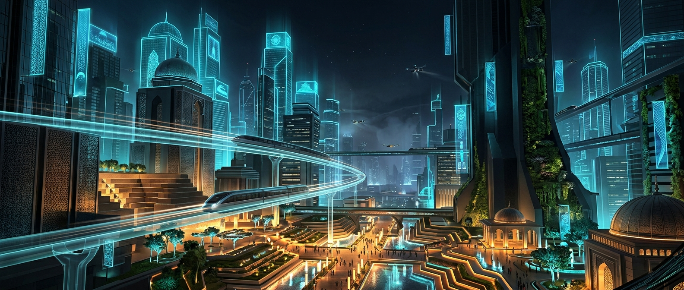
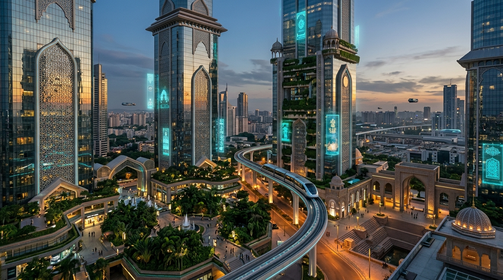
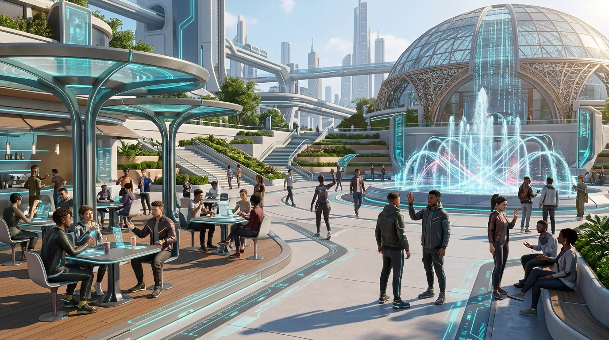

<div align="center">



# EVERYVERSE GAMING
### **LIFEVERSE 2070** — *Open-World Life Simulation, Virtual Society & Democratic Governance Universe*

**`CREATED BY DIVYESH BAMBHANIYA`**

[](CHANGELOG.md)
[](01_GAME/project.godot)
[](01_GAME/localization/messages.csv)
[](08_TESTS/)
[](02_BACKEND/app/routers/economy.py)

<p>
  <a href="#-explore-the-virtual-world">Explore World</a> •
  <a href="#-character-creation">Identity</a> •
  <a href="#-careers--life-progression">30 Careers</a> •
  <a href="#-cities-npcs--social-systems">Social &amp; NPCs</a> •
  <a href="#-economy--virtual-society">Economy</a> •
  <a href="#-technology-architecture">Tech Stack</a> •
  <a href="#-development-roadmap">Roadmap</a> •
  <a href="#-installation--deployment">Deploy</a>
</p>

</div>

---

## 🌌 Welcome to EVERYVERSE GAMING (LIFEVERSE 2070)

**LIFEVERSE 2070** is an original futuristic open-world life simulation and virtual society platform created by **Divyesh Bambhaniya**. Rather than reducing a player's journey to grinding cash or chasing a single leaderboard, EVERYVERSE GAMING is engineered around a core principle:

> *Every player has their own identity, their own ambition, and their own story. Every profession commands respect, leadership is earned through fair democratic process, and failure never erases what you have learned.*

Supported natively in **Gujarati (`ગુજરાતી`)**, **Hindi (`हिन्दी`)**, and **English**, the project pairs a **server-authoritative FastAPI + PostgreSQL backend** with an evolving **Godot 4 3D client** and a **multilingual, context-aware community safety engine**.

### Honest Implementation Status Legend
To keep expectations transparent for players and contributors, every feature below is explicitly labeled:
- ✅ **Implemented & Tested** — Live backend API, database schema, and verified automated tests (`28/28` passing).
- 🧪 **Experimental / Uncompiled** — Godot 4 `.tscn` scenes, `.gd` scripts, or static HTML portals authored in the repo, pending Godot Editor / live browser build testing.
- 🗺️ **Planned** — Architected in design documents, scheduled for future milestones.

---

## 🏙️ Explore the Virtual World

Set in the original fictional **Navabharat Confederation**, the opening district is **Suryanagar** — a walkable neo-futuristic coastal city blending solar-glass civic towers, clean monorail transit, and warm community plazas.

<table>
  <tr>
    <td width="50%" valign="top">
      <h4>🏛️ Suryanagar Central Plaza &amp; Civic Fountain</h4>
      <p>The social heart of the starter city featuring public gathering spaces, seasonal festivals, and Inspector Kabir Rao's civic safety kiosk.</p>
      <sub>Status: ✅ Backend Locations API · 🧪 <code>SuryanagarPlaza.tscn</code> (primitive 3D layout)</sub>
    </td>
    <td width="50%" valign="top">
      <h4>🔬 Navabharat Innovation University Dome</h4>
      <p>Home to Dr. Meera Patel's Quantum Lab, collaborative research projects (AI Safety, Space, Semiconductors, Climate), and career exams.</p>
      <sub>Status: ✅ Research &amp; NPC APIs · 🧪 3D Dome Landmark in Godot</sub>
    </td>
  </tr>
  <tr>
    <td width="50%" valign="top">
      <h4>☕ Skyline Solar Cafe &amp; Unity Stadium</h4>
      <p>Meet friends, trigger expressive emotes, help Ramesh Kaka with community side quests, and compete in festival trivia challenges.</p>
      <sub>Status: ✅ Social, NPC &amp; Events APIs · 🧪 3D Cafe Landmark</sub>
    </td>
    <td width="50%" valign="top">
      <h4>⚖️ Parliament, Courts &amp; Residential Quarters</h4>
      <p>Participate in constitutional Prime Minister elections, resolve civic cases, purchase solar studios or EV scooters, and grow a virtual family.</p>
      <sub>Status: ✅ Elections, Justice, Property &amp; Life APIs · 🗺️ Full 3D Districts</sub>
    </td>
  </tr>
</table>

---

## 🧬 Character Creation & Personal Identity

Players control how they appear and what they share across three privacy-first creation paths:

| Creation Method | Capabilities & Privacy Controls | Current Status |
| :--- | :--- | :--- |
| **Option A · Manual In-Game Creator** | Full customization (name, hairstyle, clothing, accessories, non-stereotyped proportions) with zero photo or AI requirement. | ✅ Backend & Cloud Save · 🧪 `CharacterCreator.tscn` |
| **Option B · Personal Photo Reference** | Explicit opt-in consent enforced server-side (`photo_consent_granted`); original photos stay private by default with delete/replace controls. | ✅ Consent Gate & Storage API · 🗺️ 3D Mesh Pipeline |
| **Option C · AI Character Concept** | Original fictional character concepts mapped onto standardized safety-checked 3D template rigs and modular outfits. | ✅ Config & Metadata API · 🗺️ Rig-Mapping Pipeline |

---

## 🎓 Careers, Dynamic Tasks & Fair National Leadership

No player can buy a top profession or unlock leadership solely through XP grinding. **LIFEVERSE 2070** separates **Player Level**, **Professional Qualification**, and **Public Trust**.

<table>
  <tr>
    <td width="33%" valign="top">
      <h4>📋 30 Functional Starter Careers</h4>
      <p>Covers all <strong>14 career categories</strong> — Scientist, AI/Space/Semiconductor Researcher, IAS-Inspired Civil Admin, IPS-Inspired Police, Cybercrime Investigator, Doctor, Surgeon, Judge, Entrepreneur, Software/Robotics Engineer, Athlete, Climate Scientist, and more.</p>
      <sub>✅ <code>career_registry.json</code> + Category Filter API</sub>
    </td>
    <td width="33%" valign="top">
      <h4>⏱️ Stages 1–3 &amp; Zero-Loss Retry</h4>
      <p>Selecting a career issues timed qualification milestones across Stages 1 → 2 → 3. Failing an evaluation <strong>never erases earned skills</strong> — players can retry, train further, or pivot careers freely.</p>
      <sub>✅ Dynamic Task Engine + Regression Tests</sub>
    </td>
    <td width="33%" valign="top">
      <h4>🏛️ Fair Prime Minister Elections</h4>
      <p>One Prime Minister per fictional country, chosen via strict <strong>one-vote-per-player</strong> constitutional elections weighted by votes, public trust, governance, and integrity — with meaningful Cabinet roles for qualified runners-up.</p>
      <sub>✅ DB <code>UNIQUE</code> Vote Guard + Cabinet Fallback</sub>
    </td>
  </tr>
</table>

---

## 🤝 Cities, NPCs & Social Systems

* **Multilingual NPCs with Persistent Memory (✅ Implemented):** Interact with **Dr. Meera Patel**, **Ramesh Kaka**, and **Inspector Kabir Rao** in Gujarati, Hindi, or English — complete humorous conversations and anti-farming side quests that reward virtual currency, knowledge, and public trust.
* **Friends, Parties & Real-Time Chat (✅ Implemented):** Friend requests and acceptance, party creation/joining, online presence tracking, player blocking/muting, and an authenticated, moderation-gated **WebSocket chat server** (`/api/v1/social/ws/chat`).
* **Family & Wellbeing (✅ Implemented):** Build virtual family bonds, track Happiness/Energy/Stress indicators, and balance work with festivals and community activities without manipulative daily-streak punishments.
* **Voice & Video Policy (🗺️ Planned):** Voice chat is planned only after dedicated safety and infrastructure review; video calling is intentionally excluded from v1.

---

## 💰 Economy & Virtual Society

**Initial Release Policy:** 100% Free-First · Non-Redeemable Virtual Currency · Zero Pay-to-Win · Zero Real-Money Gambling.

| System | How It Works | Status |
| :--- | :--- | :--- |
| **Server-Authoritative Ledger** | Every reward, purchase, and trade is validated server-side (`economy_ledger`); client-claimed balances are ignored. | ✅ Implemented & Tested |
| **Housing & EV Vehicles** | Purchase Suryanagar studios, scholar lofts, eco-homes, solar scooters, and compact EVs tied to your cloud account. | ✅ Implemented & Tested |
| **Startups & Virtual Market** | Launch startups across Clean Energy, EdTech, or Deep Tech with realistic quarterly profit **or loss** risk cycles. | ✅ Implemented & Tested |
| **Virtual Services Marketplace** | Trade mentoring, exam tutoring, crafted furniture, or outfits with other players using non-redeemable virtual currency. | ✅ Implemented & Tested |
| **Multi-Dimensional Leaderboards** | Separate rankings for **Knowledge**, **Public Trust**, and **Financial Progress** — Founder admin accounts are excluded. | ✅ Implemented & Tested |

---

## ⚙️ Technology Architecture

```text
┌────────────────────────────────────────────────────────────────────────────┐
│                        EVERYVERSE GAMING (LIFEVERSE 2070)                  │
├──────────────────────┬──────────────────────────┬──────────────────────────┤
│   01_GAME (Client)   │    02_BACKEND (API)      │   03_DATABASE & OPS      │
│   Godot 4 (Mobile)   │    FastAPI + Python 3.11 │   PostgreSQL (Neon)      │
│   7 .tscn Scenes     │    15 Modular Routers    │   SQLite (Local/Termux)  │
│   11 .gd Scripts     │    RFC 6238 TOTP 2FA     │   SHA-256 Backup/Restore │
│   GU / HI / EN CSV   │    WebSocket + Safety    │   GitHub Actions + Render│
└──────────────────────┴──────────────────────────┴──────────────────────────┘
```

| Layer | Technologies | Repository Path |
| :--- | :--- | :--- |
| **3D Game Client** | Godot 4, GDScript, ICU/CSV Localization (`en`, `gu`, `hi`) | [`01_GAME/`](01_GAME/) |
| **Backend Services** | Python 3.11+, FastAPI, Uvicorn, Pydantic, WebSockets | [`02_BACKEND/`](02_BACKEND/) |
| **Database & Backups** | PostgreSQL (Production), SQLite (Local Dev), SQL Migrations, SHA-256 Backup/Restore | [`03_DATABASE/`](03_DATABASE/) |
| **Web & Founder Portals** | Interactive HTML/JS Player Portal & Private Founder/Moderation Control Center | [`04_WEBSITE/`](04_WEBSITE/) · [`05_ADMIN_PANEL/`](05_ADMIN_PANEL/) |
| **Security & Moderation** | PBKDF2-SHA256, HMAC-SHA256 JWT, RFC 6238 TOTP 2FA, Multilingual Safety Engine | [`06_SECURITY/`](06_SECURITY/) |
| **Testing & CI** | Python `unittest` + FastAPI `TestClient` (`28` automated tests) + GitHub Actions | [`08_TESTS/`](08_TESTS/) |

---

## 🖼️ Concept Art & Media Gallery

> **Transparency Note:** The visuals below are **Original Concept Art** created to establish the artistic direction of Suryanagar and its civic plazas. Live in-engine 3D gameplay screenshots and animated GIFs will be added here once the Godot 4 scenes are compiled with custom Blender `.glb` assets.

<table>
  <tr>
    <td width="50%" align="center">
      
      <br />
      <sub><strong>Concept Art · Suryanagar Dusk Skyline</strong> — Hybrid futuristic Indian-inspired urban design &amp; elevated solar monorail.</sub>
    </td>
    <td width="50%" align="center">
      
      <br />
      <sub><strong>Concept Art · Central Social Plaza</strong> — Innovation University Dome, Skyline Solar Cafe, and live community gathering space.</sub>
    </td>
  </tr>
</table>

---

## 🗺️ Development Roadmap

| Phase | Milestone | Status |
| :--- | :--- | :--- |
| **Phase 00** | Master Game Design, 30-Role Studio Matrix & Technical Architecture | ✅ Completed |
| **Phase 01–04** | Auth, Cloud Save/Restore, 3-Language Setup, Starter City Skeleton & NPC Dialogue Engine | ✅ Backend Complete · 🧪 Godot Scenes Uncompiled |
| **Phase 05–08** | 30-Career Registry, Stages 1–3 Tasks, Zero-Loss Retry, Family/Wellbeing, Property/Vehicles & Fair PM Elections | ✅ Backend & Tests Verified |
| **Phase 09–10** | Law/Police/Judiciary, Startups & Virtual Risk/Return, Festivals, Research Labs & Virtual Services Marketplace | ✅ Backend & Tests Verified |
| **Phase 11** | Production Security Hardening (Server-Provisioned Founder MFA, Fail-Safe Reset, Strict CORS, Secret Moderation Config) | ✅ Verified (`v1.0.1`, `28/28` Tests Passing) |
| **Phase 12** | Live Neon PostgreSQL + Render Staging Verification, Custom Blender 3D Assets, Godot Android APK Compilation & OCR/STT Safety | 🗺️ Planned / In Progress |

---

## 🚀 Installation & Deployment

### Local / Termux Development
```bash
git clone https://github.com/dhundhwana-arch/EVERYVERSE-GAME.git
cd EVERYVERSE-GAME

# Install dependencies (for Android Termux without pg_config, omit psycopg2-binary)
pip install -r 02_BACKEND/requirements.txt

# Run the complete 28-test automated verification suite
PYTHONPATH=02_BACKEND python3 -m unittest discover -s 08_TESTS -v

# Start the local FastAPI server
PYTHONPATH=02_BACKEND uvicorn app.main:app --reload --host 0.0.0.0 --port 8000
```

### Production Deployment (Render + Neon PostgreSQL)
Full production settings, secret file setup, and first-time server-side Founder provisioning (`02_BACKEND/app/bootstrap_founder.py`) are documented in:
- 📄 [**Deployment Guide**](09_DOCUMENTATION/DEPLOYMENT_GUIDE.md)
- 📄 [**API Documentation**](09_DOCUMENTATION/API_DOCUMENTATION.md)
- 📄 [**Security Fix Report (v1.0.1)**](SECURITY_FIX_REPORT.md)
- 📄 [**Changelog**](CHANGELOG.md)

---

## 🛡️ Security, Content Safety & Privacy

Community safety is built directly into the server architecture — never left to client-side filters:

* **Multilingual Anti-Terrorism & Content Moderation:** Server-side normalization detects Gujarati, Hindi, English, Romanized Gujarati/Hindi, homoglyphs, leetspeak, repeated characters, and split-letter evasion across 10 prohibited categories while distinguishing legitimate **education, history, journalism, and fiction**.
* **3-Stage Escalation & Appeals:** Blocks harmful messages before delivery with escalating warnings, human review queues for uncertain context, immediate protective locks on credible imminent threats, and a full appeal workflow.
* **Production Auth Hardening:** Public registration never grants Founder privileges; Founder access requires server-side provisioning + mandatory **RFC 6238 TOTP MFA**; production strictly requires PostgreSQL (`DATABASE_URL`) and fails closed on unconfigured SMTP or missing secret moderation rules.
* **Privacy Controls:** Minimal data collection, full player data export (`/api/v1/auth/export-data`), and self-service account deletion (`/api/v1/auth/delete-account`). Read the full [**Security Threat Model**](06_SECURITY/SECURITY_THREAT_MODEL.md).

---

## 👑 Founder Credits & Contributing

<div align="center">

### **CREATED BY DIVYESH BAMBHANIYA**
*Founder, Creator & Lead Architect — EVERYVERSE GAMING / LIFEVERSE 2070*

GitHub: [**@dhundhwana-arch**](https://github.com/dhundhwana-arch) · Repository: [**EVERYVERSE-GAME**](https://github.com/dhundhwana-arch/EVERYVERSE-GAME)

</div>

Contributions, bug reports, security disclosures, and 3D Godot/Blender asset proposals are welcome via Pull Requests against feature branches (direct pushes to `main` are restricted). Please run the full test suite before opening a PR.
